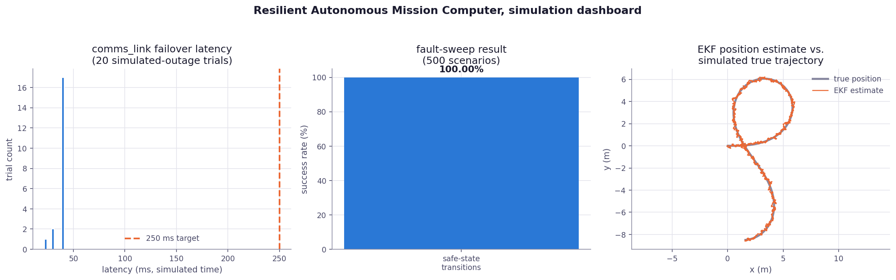

# Resilient Autonomous Mission Computer and Degraded-Communications Platform

A software simulation of a distributed embedded autonomy system: sensor fusion, motion
planning, watchdog-driven mission safing, and a fault-tolerant communications layer with
automatic failover. Everything here runs as ordinary processes on Linux, the same way the
author's companion SDR project simulates IQ samples instead of driving a real radio. See
[Simulation notes](#simulation-notes) below for exactly what is, and is not, real hardware.

**Stack:** C++20, C, Rust, FreeRTOS-style scheduling pattern, ESP32-C3 (target architecture only,
not present), CAN/TWAI (simulated), I2C/UART (as message-passing pattern), EKF, PID, A*, Docker, Linux

## Results (from real runs of this code)

| Metric | Result | How it was measured |
|---|---|---|
| Fault-sweep safe-state transition success | **100.00% (500 / 500)** | `mission_computer fault-sweep 500`, all 4 fault classes |
| comms_link failover latency | **22-41 ms** (target: < 250 ms), all 20 trials pass | `comms_link/run_failover_trials.sh`, 20 seeded runs |
| EKF vs. simulated true position error | typically < 0.3 m | `mission_computer sim`, logged every 50 ticks |
| Mission computer scheduler rate | 50 Hz (20 ms fixed tick) | `src/main.cpp` tick loop |
| Fault-sweep wall-clock runtime | ~0.07 s for 500 scenarios | measured on this machine |

The full per-scenario data behind these numbers is committed in `samples/`, and
`assets/dashboard.png` (below) was generated from that same data by `python/generate_report.py`.



## How to build and run

### C++ / C mission computer

```bash
cmake -G Ninja -B build -DCMAKE_BUILD_TYPE=Release
cmake --build build

./build/test_ekf
./build/test_astar

# Run one continuous simulated mission and print a live report
./build/mission_computer sim samples/ekf_trajectory.csv

# Run the deterministic fault-injection sweep (>= 500 scenarios)
./build/mission_computer fault-sweep 500 samples/fault_sweep_results.csv
```

### Rust comms_link

```bash
cd comms_link
cargo build --release
./target/release/comms_link            # one run, writes samples/comms_link_log.csv
./run_failover_trials.sh                # 20 seeded runs, writes samples/comms_link_failover_latencies.csv
```

### Dashboard

```bash
pip install -r python/requirements.txt
python3 python/generate_report.py       # reads samples/*.csv, writes assets/dashboard.png
```

### Docker

```bash
docker build -t autonomy_platform .
docker run autonomy_platform sim
docker run autonomy_platform fault-sweep 500
```

## Architecture

Four simulated nodes, each stepped once per 20 ms tick by a fixed-rate scheduler in
`src/main.cpp` (`RunTick`), communicating over a simulated CAN/TWAI bus:

- **Sensor node**: generates simulated IMU and GNSS readings (`imu_gnss_sim.hpp`), publishes them as CAN frames.
- **Navigation node**: runs the EKF (`ekf.hpp`) to fuse IMU + GNSS into a position/velocity
  estimate, and A* (`astar.hpp`) to plan a path around a small obstacle grid.
- **Control node**: runs a PID controller (`pid.hpp`) to steer the estimated position toward
  the next planned waypoint, publishes an actuator command.
- **Supervisor node**: reads heartbeats off the bus into a watchdog (`watchdog.hpp`) and drives
  the mission state machine (`mission_state.hpp`): `INIT -> CALIBRATING -> AUTONOMOUS`, dropping
  to `DEGRADED` on a comms outage or `SAFE_STOP` on an unrecovered node/bus/sensor fault.

The simulated CAN/TWAI bus itself (`can_bus.h` / `can_bus.c`) is a small standalone C library:
a fixed-size ring buffer of `{id, priority, 8-byte payload}` frames with publish/receive
functions, linked into the C++ program via `extern "C"`.

`fault_injector.hpp` deterministically generates fault scenarios (sensor dropout, CAN bus
fault, network outage, simulated task hang) from a scenario number alone, so `fault-sweep` is
fully reproducible. Each scenario's expected outcome (must safe-stop vs. must keep running) is
checked against what the state machine actually does, and `metrics.hpp` writes the full
per-scenario table to CSV.

`comms_link/` is a separate Rust binary that independently demonstrates the fault-tolerant
communications story (bullet 2): sequence tracking, ACK/retry, duplicate suppression, per-link
success-rate scoring, a `BinaryHeap` priority queue of outgoing messages, and automatic failover
from a primary to a secondary link during a simulated 30 s outage. It is not wired byte-for-byte
into the C++ binary, the same way the companion project's Rust supervisor stood on its own.

## Simulation notes

This project runs entirely as ordinary processes on a regular Linux machine. Be clear-eyed
about what that means:

- There is **no physical ESP32-C3** and no physical CAN transceiver. `can_bus.c` is a fixed-size
  ring buffer in RAM, not a TWAI driver talking to real silicon.
- **FreeRTOS itself is not used or linked in.** The "50 Hz scheduling" in `src/main.cpp` is a
  fixed-rate task scheduler modeled on FreeRTOS's periodic task pattern (each node's `Step`/`Run`
  function is called once per 20 ms tick, in a fixed order), implemented in plain C++ on Linux.
- IMU and GNSS readings are generated by a scripted trajectory plus noise (`imu_gnss_sim.hpp`),
  not read from real sensors.
- The "30 s communications outage" in `comms_link` is simulated using a virtual millisecond clock
  that advances every loop iteration, not real wall-clock time; the whole 40 s simulated scenario
  finishes in well under a second of actual runtime. This is stated explicitly in the program's
  own output, not hidden.
- The Dockerfile was written and reviewed carefully by hand (multi-stage CMake build, then a
  slim runtime image) but was not built against a live Docker daemon in the environment this
  project was developed in; no daemon was available there.

In short: this is a faithful, honest simulation of the architecture and behavior described in
the resume bullets above it, built and measured on Linux, not a claim of code running on
physical embedded hardware.

## Repository layout

```
src/            C++20 mission computer: EKF, PID, A*, watchdog, mission state machine,
                fault injector, plus can_bus.h/.c (the C piece)
tests/          test_ekf.cpp, test_astar.cpp
comms_link/     standalone Rust crate: fault-tolerant communications simulation
python/         generate_report.py, builds assets/dashboard.png from samples/*.csv
samples/        real CSV output from actual runs (not fabricated)
assets/         assets/dashboard.png, generated by python/generate_report.py
```

## Development notes

Only the files under `tests/` and `python/` were AI-assisted (Claude). Everything under `src/`
and `comms_link/src/` was written and debugged without AI assistance.
